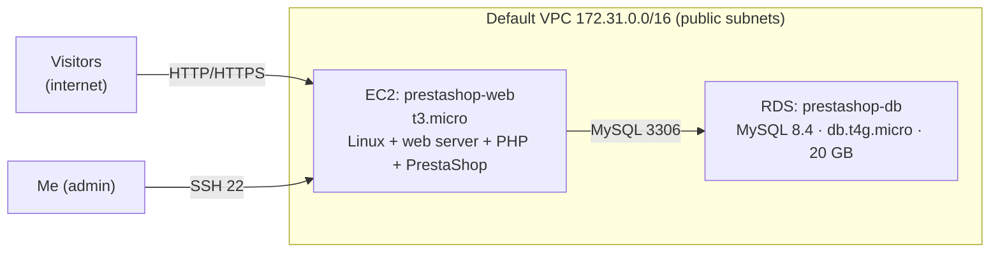
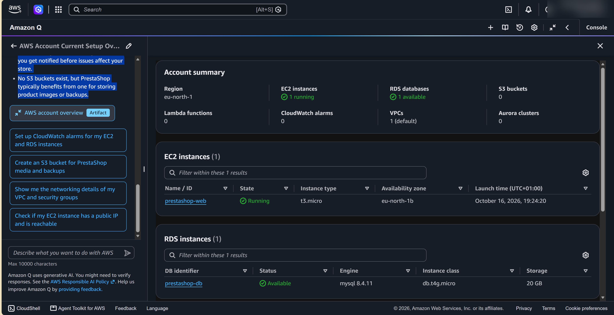
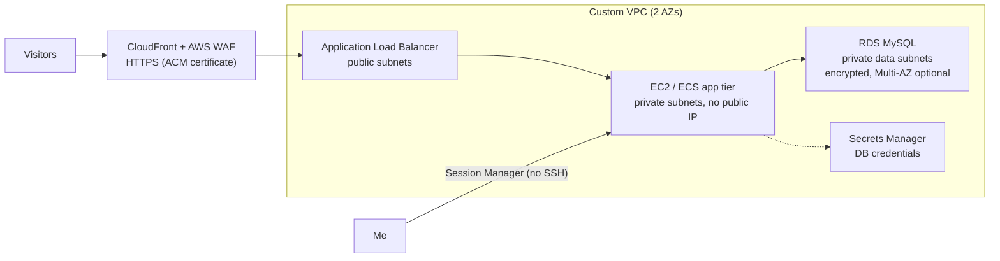

# Project 00 · Deploying PrestaShop on AWS, and what I'd do more securely now

**Context:** a technical task for a DevOps internship application: deploy the PrestaShop e-commerce platform on AWS. I passed that stage. Looking back with a security lens, this write-up covers what I built, what it cost, and how I'd rebuild it today.

| | |
| --- | --- |
| **Built** | 16 October 2026 |
| **Region** | eu-north-1 (Stockholm), availability zone eu-north-1b |
| **Status** | Backed up (RDS snapshot + AMI) and shut down on 26 October 2026 to save credits |
| **Skills** | EC2, RDS (MySQL), VPC basics, security groups, Linux web server, cost awareness |

## 1. What I built

| Component | Configuration | Role |
| --- | --- | --- |
| **EC2** `prestashop-web` | t3.micro, eu-north-1b, default VPC | Runs the web server, PHP and PrestaShop |
| **RDS** `prestashop-db` | MySQL 8.4.11, db.t4g.micro, 20 GB storage | Managed database for products, orders and customers |
| **VPC** | The default VPC (172.31.0.0/16) | Network the resources ran in |
| **Security groups** | _TODO: inbound rules from the security review_ | Firewall rules for EC2 and RDS |

## 2. How I deployed it

> _TODO, my own words:_
> 1. How I launched the instance (which AMI / OS, key pair, security group)
> 2. How I installed the web stack (manually, Docker, or a ready-made image)
> 3. How I created the RDS database and connected PrestaShop to it
> 4. How I reached the store (public IP / domain, HTTP or HTTPS)
> 5. What broke, and how I fixed it

## 3. What it cost

- About **$8.18 in the first 10 days** (EC2 + RDS + public IPv4), about **$25/month** if left running, all covered by free-plan credits.
- **Lesson:** cloud resources bill by the hour whether anyone uses them or not. Since then, I set budget alerts before building anything, and I tear down or back up resources when a task is finished.

## 4. Security review (done afterwards)

| Check | Finding | Risk |
| --- | --- | --- |
| EC2 inbound rules | _TODO_ (e.g. SSH 22 open to `0.0.0.0/0`?) | Anyone on the internet can attempt SSH logins |
| EC2 public IP | _TODO_ | The server is directly exposed |
| RDS "Publicly accessible" | _TODO_ | A database reachable from the internet |
| RDS security group (3306) | _TODO_ | Who can reach the database |
| Encryption (EBS, RDS) | _TODO_ | Data at rest |
| HTTPS | _TODO_ | Credentials and customer data sent in plain text over HTTP |
| Database credentials | Stored in PrestaShop's config file on the server | Anyone with server access can read them |
| Monitoring / logging | No CloudWatch alarms; CloudTrail _TODO_ | Attacks or outages go unnoticed |
| Backups | RDS automated backups _TODO_; manual snapshot taken at shutdown | Recovery from mistakes or ransomware |

## 5. How I'd rebuild it securely today

| Area | Then | Now |
| --- | --- | --- |
| **Network** | Default VPC, public subnets | Custom VPC: public subnets only for the load balancer; app and database in **private** subnets |
| **Admin access** | SSH from the internet | **Session Manager**: no open port 22, no key files, every session logged |
| **Database exposure** | _TODO_ | **Not publicly accessible**; security group allows 3306 **only from the app's security group** |
| **Encryption in transit** | _TODO_ | **HTTPS** with a free ACM certificate on CloudFront/ALB; HTTP redirected to HTTPS |
| **Web protection** | None | **AWS WAF** managed rules (SQL injection, XSS, bad inputs) + rate limiting |
| **Secrets** | DB password in a config file | **Secrets Manager**, fetched at deploy time; the instance gets it through its **IAM role** |
| **Instance hardening** | Defaults | **IMDSv2 required**, minimal packages, automatic patching with Systems Manager Patch Manager |
| **Encryption at rest** | _TODO_ | EBS and RDS encrypted with KMS |
| **Backups** | Manual | RDS automated backups + **deletion protection**; AWS Backup for the instance |
| **Monitoring** | None | CloudTrail on, CloudWatch alarms (CPU, storage, 5xx errors), **GuardDuty** |
| **Cost control** | Discovered after the fact | **Budget alerts** first; tags on every resource; tear down when finished |
| **Repeatability** | Built by hand in the console | **Terraform**, so the whole stack is built, reviewed and destroyed from code |

## 6. What I learned

- How a classic web app (web server + PHP + MySQL) maps onto AWS: EC2 for compute, RDS for a managed database, VPC and security groups for the network.
- Managed services (RDS) remove work, such as patching and backups, but not responsibility: the configuration is still mine (the **shared responsibility model**).
- Working is not the same as secure: the first version worked, and the review above found the gaps.
- **Cost is a security signal too:** unexpected spend can mean forgotten resources or a compromised account.

## 7. Next

This project's secure redesign becomes the **capstone** of my plan: a secure 3-tier app built with Terraform, monitored by a SIEM, with automated incident response.
