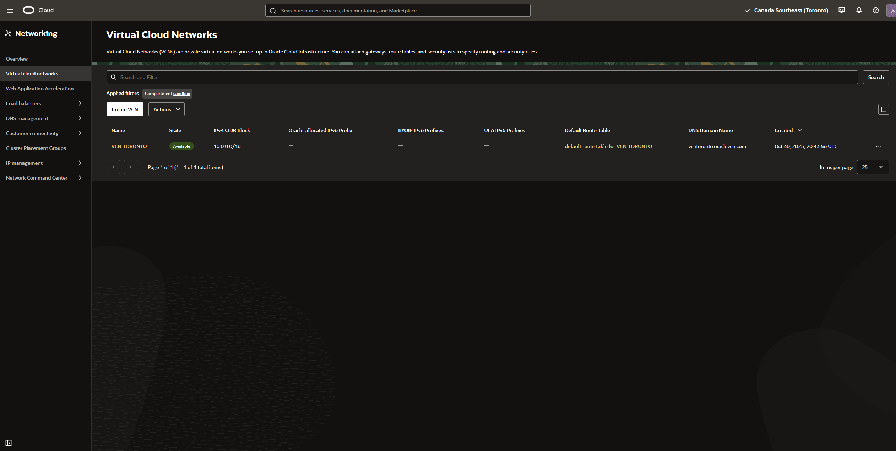
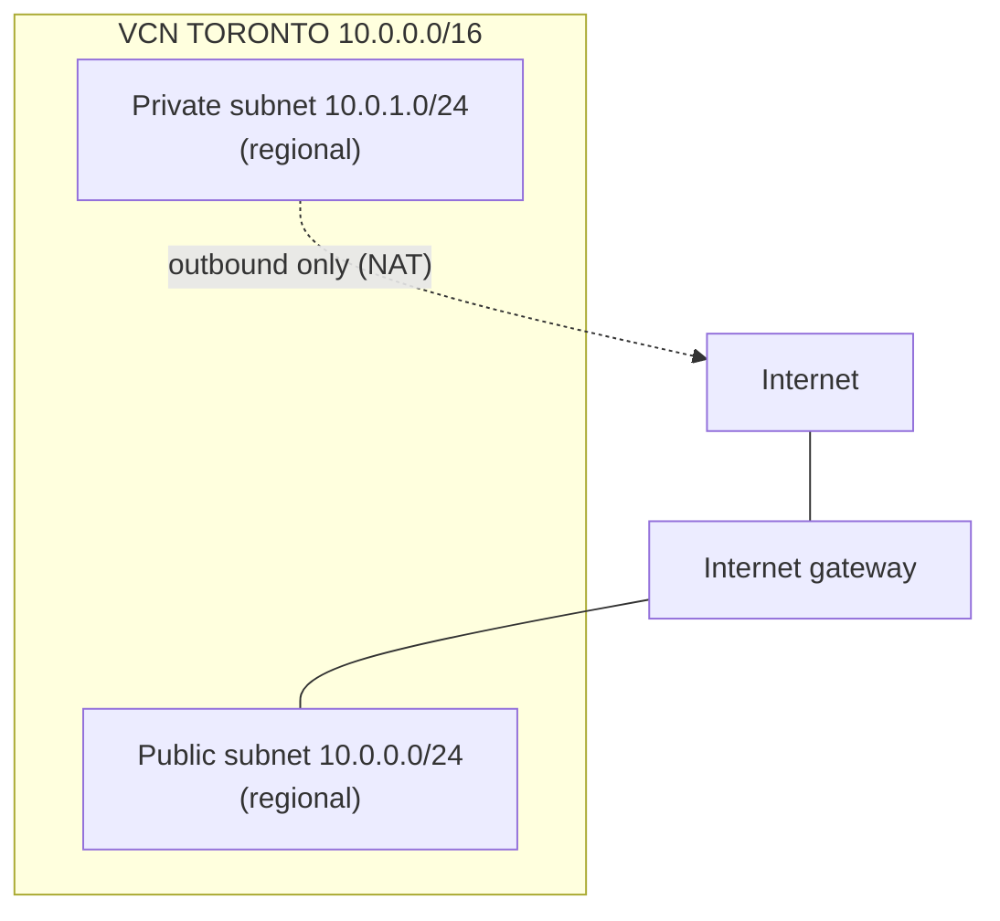
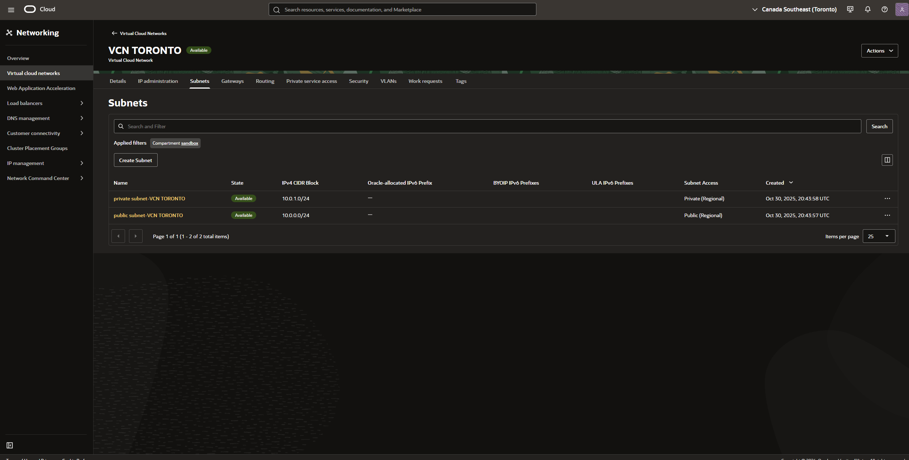
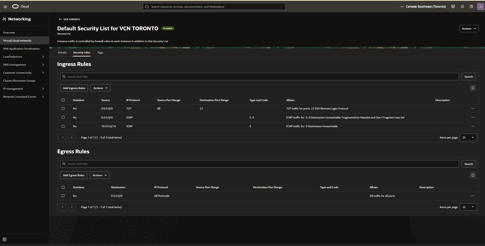
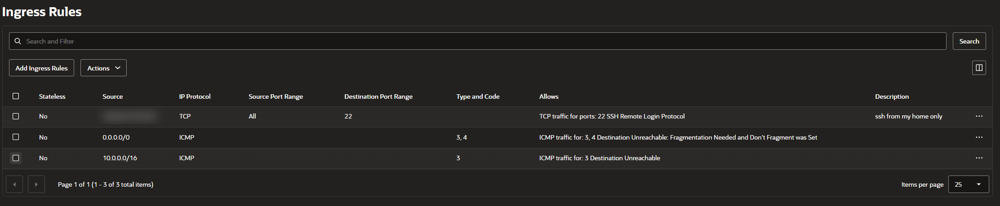

# OCI-01 · Security review of an Oracle Cloud network (VCN)

**What:** I audited a virtual cloud network I had created a year earlier in Oracle Cloud (OCI), found three design and security issues, and fixed the most urgent one.
**Why:** finding what already exists and checking it against least privilege is the first job in any cloud security role (NIST CSF: *Identify*, then *Protect*).
**Cost:** $0 (Always Free)

| | |
| --- | --- |
| **Provider / region** | Oracle Cloud Infrastructure · Canada Southeast (Toronto) |
| **Compartment** | `sandbox` |
| **VCN** | `VCN TORONTO` · `10.0.0.0/16` · created 30 Oct 2025 |
| **Skills** | Cloud networking (VCN, subnets, gateways, routing), firewall rule review, least privilege, IP planning |

## 1. What I found

| Subnet | CIDR | Access |
| --- | --- | --- |
| public subnet | 10.0.0.0/24 | Public (regional): resources can have public IPs |
| private subnet | 10.0.1.0/24 | Private (regional): no public IPs |

## 2. The firewall rules (default security list), rule by rule

All rules are **stateful** (Stateless = No): replies to allowed traffic return automatically.

| # | Direction | Rule | What it allows | Verdict |
| --- | --- | --- | --- | --- |
| 1 | Ingress | TCP 22 from `0.0.0.0/0` | Anyone on the internet can attempt SSH | ⚠️ **Too open**, fixed below |
| 2 | Ingress | ICMP 3,4 from `0.0.0.0/0` | "Fragmentation needed" messages | ✅ Keep: path MTU discovery needs it |
| 3 | Ingress | ICMP 3 from `10.0.0.0/16` | "Destination unreachable" inside the VCN | ✅ Keep: troubleshooting |
| 4 | Egress | All protocols to `0.0.0.0/0` | Instances can connect anywhere | ⚠️ Not least privilege; accepted for a learning lab |

## 3. Findings

| ID | Finding | Risk | Severity | Action |
| --- | --- | --- | --- | --- |
| F1 | SSH (22) open to the whole internet | Automated brute-force and exploit attempts against any instance in the subnet | **High** | ✅ Restricted to my home public IP (`/32`) |
| F2 | Egress allows all traffic everywhere | A compromised instance could reach any server (command and control, data theft) | Medium | Accepted for the lab. Production: allow only 80/443 (updates), 53 (DNS), 123 (NTP) |
| F1b | First SSH fix used a VPN exit IP (shared, changing), not my home IP | The /32 would admit other VPN users and break when the exit changed | Medium | ✅ Corrected to my real ISP IP |
| F3 | VCN range `10.0.0.0/16` overlaps my home lab (LAN 10.0.1.0/24 is *identical* to this private subnet) | Connecting the networks later (VPN) would break routing | Low (design) | Documented. Future OCI networks use `10.50.0.0/16`, AWS uses `10.40.0.0/16` |

## 4. The fix (F1)

1. Found my public IP (`curl -s https://ifconfig.me`). All my home devices share it through NAT.
2. Edited ingress rule 1: source `0.0.0.0/0` → `MY.PUBLIC.IP/32`, description "SSH from my home only".

SSH now accepts connections from exactly one address (my home public IP, blurred). The ICMP rules are unchanged.

**Lesson: check which IP the cloud really sees.** My first fix used the address whatismyip showed, but it was a Cloudflare range (`104.28.x.x`): I was browsing through a VPN. A VPN exit IP is shared with other users and changes often, so the rule allowed the VPN rather than my home. With the VPN off, my real ISP address appeared, and I updated the rule to that `/32`. When connecting, the VPN must stay off.

**Trade-off:** my ISP gives a dynamic IP, so the rule must be updated when it changes. The stronger long-term option is **OCI Bastion** (time-limited SSH sessions with no port open to the internet), the equivalent of AWS Session Manager.

## 5. Still to check

- [ ] Which security list is attached to each subnet (default vs private)?
- [ ] Route tables: public → internet gateway; private → NAT gateway?
- [ ] Any compute instances still running in this VCN from 2025?

## 6. How this maps to AWS

| OCI | AWS |
| --- | --- |
| VCN | VPC |
| Public / private subnet | Public / private subnet |
| Security list | Network ACL (but stateful by default) |
| Network security group (NSG) | Security group |
| Internet gateway / NAT gateway | Internet gateway / NAT gateway |
| OCI Bastion | Systems Manager Session Manager |

## 7. What I learned

- A subnet is public because of its **route to an internet gateway**, not because of its name.
- Default rules are written for convenience, not security; reviewing them is part of the job.
- Not every "open to the world" rule is bad: ICMP type 3 code 4 must stay open or connections can silently fail.
- IP planning matters even in labs: overlapping ranges block future connections.

## Explain it back

1. Why does OCI's default security list allow ICMP type 3 code 4 from anywhere?
2. What's the risk of "egress: all traffic to anywhere"?
3. After the fix, what happens when a bot in another country tries SSH on port 22?
